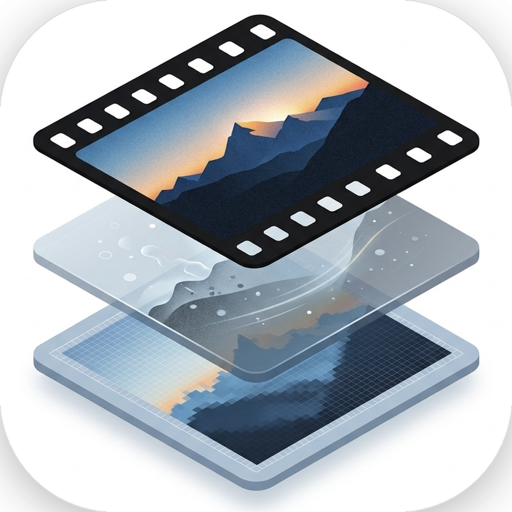
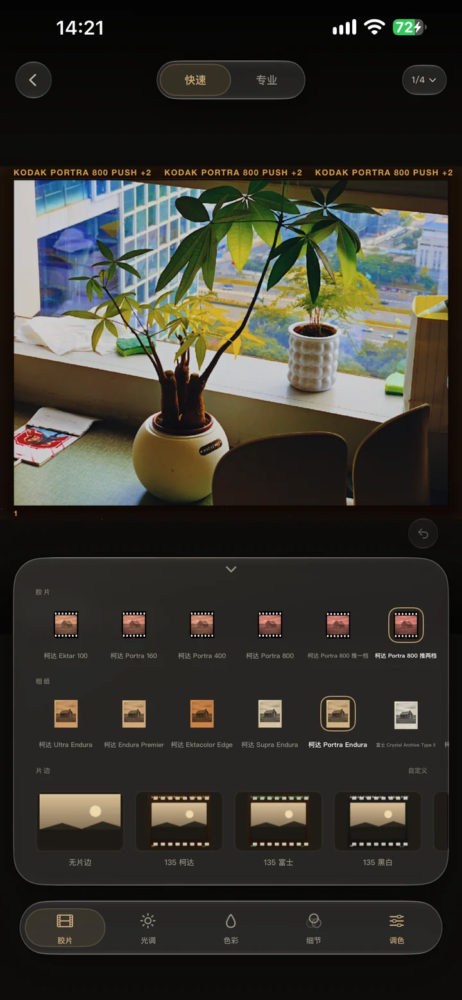
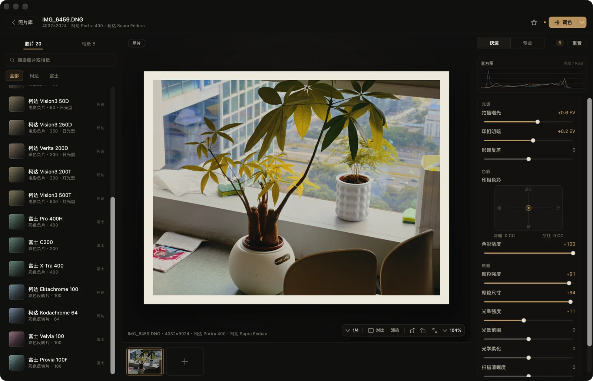

<div align="center">
  
  <h1>SpektraFilm Oltra · 欧胶片</h1>
  <p>光谱胶片模拟 · 原生 iOS 暗房<br>Spectral film simulation, natively on iPhone</p>
  <p>
    
    
    
    
  </p>
  <p>
    <a href="https://spektra.ote.asia">官网 / Website</a> ·
    <a href="https://github.com/Ote65/spektraFilmOltra/releases">下载 / Releases</a> ·
    <a href="#ios">iOS 安装</a>
  </p>
</div>

## 中文介绍

**SpektraFilm Oltra（欧胶片）** 是 [spektrafilm](https://github.com/andreavolpato/spektrafilm)（GPLv3）的衍生版本：保留上游的光谱胶片模拟内核，重做前端交互，并补齐 iOS 与 Windows 两条产品线。

- **iOS 原生版**：SwiftUI，iPhone（iOS 17+）。导入 RAW / DNG / JPEG / HEIC，按胶片 stock 做光谱显影，在暗房里调光色与曲线，加片边、日期戳与做旧瑕疵，最后直接导出到相册。全程本地离线运行，照片不出手机。
- **Windows / Electron 版**：Electron + React 界面，Python 引擎以本地 sidecar 运行，提供 NSIS 安装包。
- **Python / Qt 参考版**：上游参考实现与 Oltra 皮肤，用于算法对拍和桌面开发。

## English

**SpektraFilm Oltra** is a derivative of [spektrafilm](https://github.com/andreavolpato/spektrafilm) (GPLv3). It keeps the upstream spectral film-simulation engine and rebuilds the front end, adding native product lines on top of the original Python/Qt reference:

- **Native iOS app** — SwiftUI, iPhone (iOS 17+). Import RAW / DNG / JPEG / HEIC, develop with spectral film stocks, grade light and color in a darkroom-style bench, add film borders, date stamps and aged surface defects, then export straight to Photos. Everything runs on-device and offline; photos never leave the phone.
- **Windows / Electron** — React interface with a local Python engine sidecar, distributed as an NSIS installer.
- **Python / Qt reference** — the upstream-based reference build used for parity checks and desktop development.

> The development, color, film and paper models come from upstream spektrafilm. Oltra's changes focus on the interface, interaction, parameter mapping and platform ports.

## 界面 / Screens

<p align="center">
  
  
</p>

## 分支

| 分支 | 平台 | 用途 |
|---|---|---|
| `python` | Python + Qt/napari | 上游参考实现基线（默认分支） |
| `skin` | Python + Qt | Oltra 视觉皮肤 |
| `OltraFilm` | Python + Qt | Oltra 桌面主线 |
| `electron` | Windows / macOS | Electron 前端 + Python 引擎 |
| `iOS` | iPhone | SwiftUI 原生 App |

```bash
git clone https://github.com/Ote65/spektraFilmOltra.git
cd spektraFilmOltra
git checkout electron   # 或 iOS / python
```

## 下载与安装

### Windows（推荐）

系统要求：Windows 10/11 x64。

1. 打开 [Releases](https://github.com/Ote65/spektraFilmOltra/releases)。
2. 下载最新的 `SpektraOltra-Setup-<版本>.exe`（当前为 `v0.1.1-win`）。
3. 双击安装，可自选安装目录；完成后从桌面或开始菜单启动 **SpektraOltra**。
4. 若 Windows SmartScreen 提示“未知发布者”，选择 **更多信息 → 仍要运行**。

安装包已内置 Python 引擎。首次启动会做一次 numba JIT 预热，前几十秒渲染偏慢，之后恢复正常。

### iOS

系统要求：iPhone（iOS 17 或更高）；构建需要 macOS 与 Xcode。

[Releases](https://github.com/Ote65/spektraFilmOltra/releases) 里有开发签名的内测 IPA（当前 `v0.4.1-ios`）：只有已登记在开发者设备列表里的 iPhone 能直接安装，其他手机请用下面的方式重签。

**方式 A：Xcode 直接安装（推荐）**

1. 检出 `iOS` 分支，打开 `SpektraMobileApp/SpektraMobile.xcodeproj`。
2. 在 **Signing & Capabilities** 选择自己的 Apple ID Team，并把 Bundle Identifier 改为唯一值（例如 `com.example.spektrafilm`）。
3. 连接 iPhone，选中设备后 Run。
4. 免费 Apple ID 的证书 7 天有效，到期后重新 Run 即可。

**方式 B：IPA + 自签名工具**

1. 从 Releases 下载内测 IPA，或按“iOS 开发构建”生成未签名 IPA。
2. 用 [Sideloadly](https://sideloadly.io/) 或 AltStore 使用自己的 Apple ID 签名并安装。
3. 若提示签名身份失效（`0xe8008018`），清除工具里的旧证书后重新签名；安装时保持设备解锁亮屏。

## 从源码开发

### Electron（Windows / macOS）

前置：Python 3.13、Node.js 22 LTS、Git。Windows 不需要 Visual Studio 或 conda。

完整步骤与已知差异见：[Spektrafilm Electron 分支说明与 Windows 环境配置](https://github.com/Ote65/spektraFilmOltra/blob/electron/Spektrafilm%20Electron%20%E5%88%86%E6%94%AF%E8%AF%B4%E6%98%8E%E4%B8%8E%20Windows%20%E7%8E%AF%E5%A2%83%E9%85%8D%E7%BD%AE.md)。

```powershell
# Windows，在仓库根目录
git checkout electron
py -3.13 -m venv .venv
.\.venv\Scripts\python -m pip install -U pip
.\.venv\Scripts\pip install -e . --no-deps
.\.venv\Scripts\pip install "numpy~=2.4" "scipy~=1.17" "colour-science~=0.4.6" `
  "scikit-image~=0.26" "matplotlib~=3.10" "opt-einsum~=3.4.0" "numba~=0.64" `
  "OpenImageIO~=3.1.11" "pyfftw~=0.15.0" "rawpy~=0.26.1" "exiv2~=0.18.1" `
  "lensfunpy~=1.18.0" "Pillow~=12.1"
```

验证引擎能启动（看到 `{"event": "ready", "port": ...}` 后按 Ctrl+C）：

```powershell
.\.venv\Scripts\python -m spektrafilm_service --port 0
```

启动前端：

```powershell
cd electron
npm install
npm run build
npx electron .
```

macOS 上把 `.venv\Scripts\` 换成 `.venv/bin/`，并使用热更新模式：

```bash
cd electron
npm install
npm run dev
```

打包 Windows 安装包（输出到 `electron/release/`）：

```powershell
cd electron
npm run dist:win
```

打包前需确认 Python 引擎 sidecar 已生成在 `electron/build/spektra-engine/`（由 PyInstaller 产出）；缺少该目录时安装包不会携带引擎。

### iOS

前置：macOS 14+、Xcode（含 iOS 17+ SDK）、可用的 Apple ID。

```bash
git checkout ios
cd SpektraMobileApp
open SpektraMobile.xcodeproj
```

在 Xcode 里选择自己的 Team 后直接 Run。命令行编译模拟器版本：

```bash
xcodebuild -project SpektraMobile.xcodeproj -scheme SpektraMobile \
  -configuration Debug -destination 'generic/platform=iOS Simulator' \
  CODE_SIGNING_ALLOWED=NO build
```

生成未签名 IPA：

```bash
xcodebuild -project SpektraMobile.xcodeproj -scheme SpektraMobile \
  -configuration Release -sdk iphoneos -derivedDataPath build \
  CODE_SIGNING_ALLOWED=NO build

mkdir -p build/Payload
cp -R build/Build/Products/Release-iphoneos/SpektraMobile.app build/Payload/
(cd build && zip -qr Spektrafilm-unsigned.ipa Payload)
```

工程结构由 `SpektraMobileApp/project.yml` 定义。新增源文件或目录后，用 [XcodeGen](https://github.com/yonaskolb/XcodeGen) 重新生成：

```bash
cd SpektraMobileApp
xcodegen generate
```

### Python / Qt 参考版

```bash
python3.13 -m venv .venv
source .venv/bin/activate        # Windows: .venv\Scripts\activate
pip install -e .
spektrafilm
```

核心算法位于 `src/spektrafilm/`；GUI 位于 `src/spektrafilm_gui/`；Electron 使用的本地服务层位于 `src/spektrafilm_service/`。

## 文档

- [Electron 分支说明与 Windows 环境配置](https://github.com/Ote65/spektraFilmOltra/blob/electron/Spektrafilm%20Electron%20%E5%88%86%E6%94%AF%E8%AF%B4%E6%98%8E%E4%B8%8E%20Windows%20%E7%8E%AF%E5%A2%83%E9%85%8D%E7%BD%AE.md)
- [Spektra UI 结构说明](https://github.com/Ote65/spektraFilmOltra/blob/electron/Spektra%20UI%20%E8%AE%BE%E8%AE%A1%E8%AF%B4%E6%98%8E.md)
- iOS 对拍报告：`ios` 分支的 `docs/parity_report.md`

## 说明

- 用户资产（照片库、预设、导出文件）不会提交到仓库。
- 问题反馈请开 [Issue](https://github.com/Ote65/spektraFilmOltra/issues)；提交前请附上系统、版本与复现步骤。

## 许可与致谢

本项目沿用上游 [spektrafilm](https://github.com/andreavolpato/spektrafilm) 的 **GPLv3** 许可，源码见 [LICENSE](LICENSE)。胶片/相纸数据来自公开技术资料；JSON profile 与 LUT 遵循上游的 CC BY-SA 4.0 与自定义 LUT 许可，详见 `SPEKTRAFILM_LICENSE.txt`。

感谢 Andrea Volpato 与 spektrafilm 社区提供的光谱胶片模拟参考实现。
